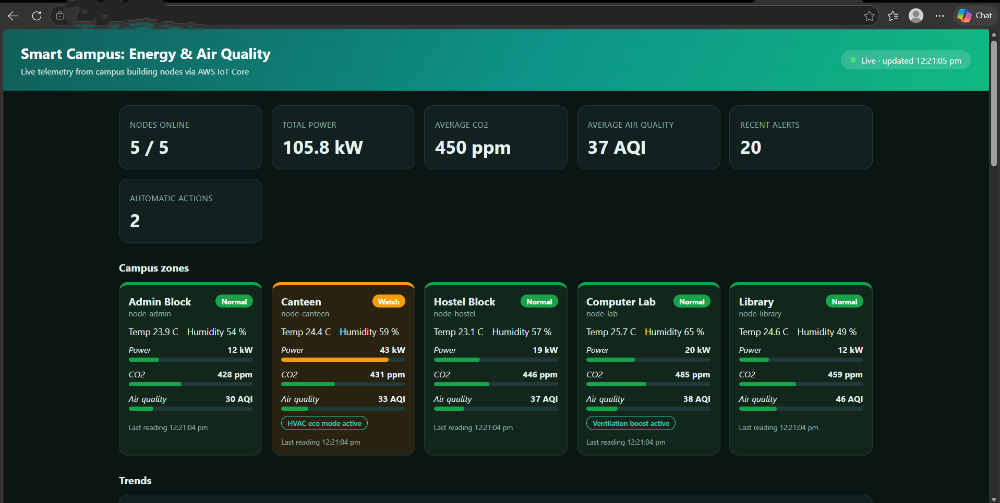
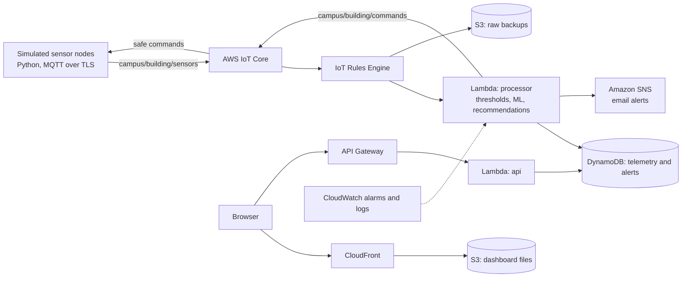
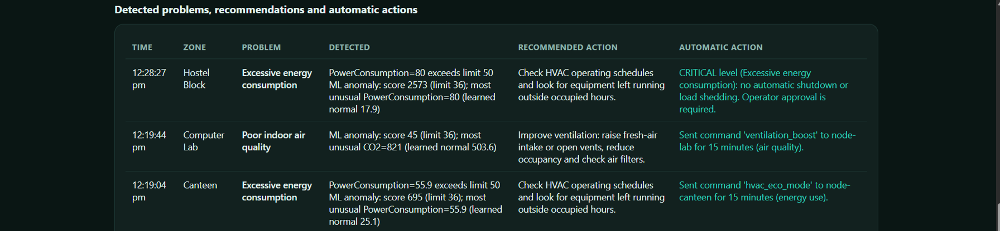
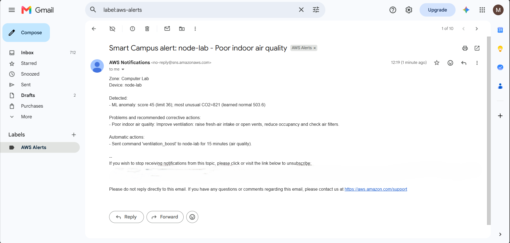
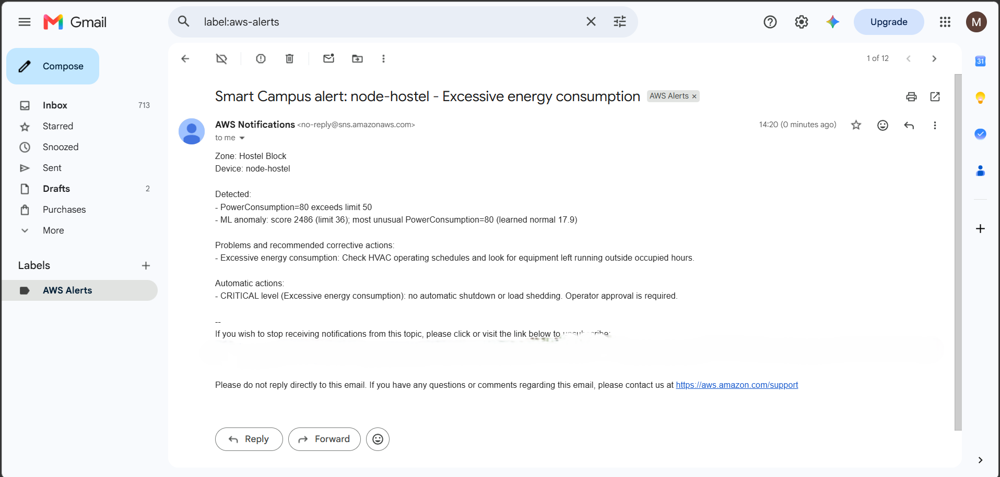
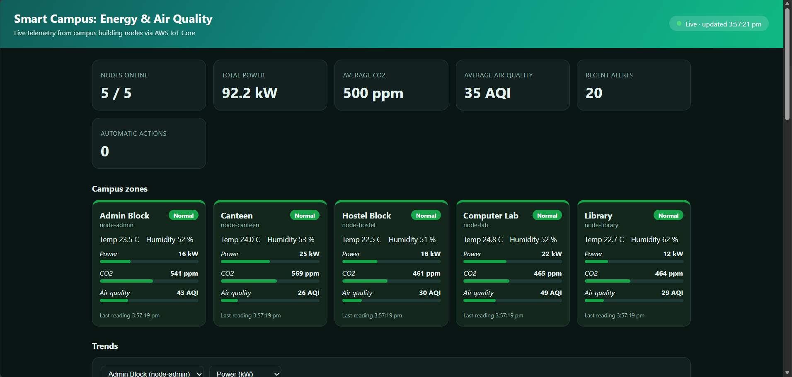

# Smart Campus IoT Energy & Air Quality Monitor

A serverless AWS project that watches simulated campus buildings in real time, detects abnormal energy use and poor indoor air quality (with a small machine learning model), alerts facility managers by email, recommends fixes, and safely triggers low-risk corrective actions. All infrastructure is built with Terraform.



## Why this project exists

Commercial and educational buildings waste energy through unmonitored HVAC cycles and have little visibility into indoor air quality, which affects health and productivity. Traditional monitoring needs expensive on-premise hardware and SCADA software. This project shows a low-cost cloud alternative: sensors stream to AWS, the cloud detects problems, tells people what to do, and when it is safe, acts by itself.

## What it does

| # | Capability | How it is done |
|---|---|---|
| 1 | Real-time monitoring | 5 simulated sensor nodes publish temperature, humidity, air quality, CO2 and power every 10 seconds over MQTT with TLS to AWS IoT Core |
| 2 | Detect abnormal conditions | Fixed limits plus an unsupervised machine learning model that learns what normal looks like for each zone |
| 3 | Automatic alerts | Amazon SNS emails facility managers |
| 4 | Corrective recommendations | Every problem gets advice, e.g. "check HVAC operating schedules" or "improve ventilation" |
| 5 | Dashboard | Live readings, trends, detected problems, alerts and recommended actions |
| 6 | Safe automatic actions | Low-risk commands (ventilation boost, HVAC eco mode) are sent back to the devices. Critical actions are never automatic |

## Architecture



**Data flow**

1. A simulated node publishes a JSON reading to the topic `campus/building/sensors`.
2. The IoT Rules Engine sends each message to the `processor` Lambda and also backs it up to S3.
3. The Lambda stores the reading in DynamoDB and checks it against fixed limits and the ML model.
4. If something is wrong, it names the problem, adds a recommendation, may send a safe command, stores an alert and emails it through SNS.
5. The node receives the command on `campus/building/commands` and changes its behaviour. The next readings show the effect.
6. The dashboard (S3 behind CloudFront) reads the data through API Gateway and a read-only Lambda.

## AWS services

| Service | Purpose |
|---|---|
| AWS IoT Core | MQTT connections, X.509 device certificates, topics |
| IoT Rules Engine | Routes every message to Lambda and S3 |
| Lambda | `processor` (detection, ML, recommendations, actions) and `api` (dashboard backend) |
| DynamoDB | Telemetry (kept 7 days) and alerts (kept 30 days) |
| SNS | Email alerts |
| S3 | Dashboard hosting and raw telemetry backups |
| CloudFront | HTTPS delivery of the dashboard |
| API Gateway | `/latest`, `/history`, `/alerts` endpoints |
| IAM | Least-privilege roles and device policy |
| CloudWatch | Logs and 4 alarms (Lambda errors and throttles) |

Optional extras for the custom domain: AWS Certificate Manager (free certificate) and any external DNS provider.

## How abnormal conditions are detected

1. **Fixed limits:** air quality above 150, CO2 above 1000 ppm, power above 50 kW, temperature above 35 C.
2. **Machine learning:** for each zone the Lambda learns a multivariate Gaussian model (Mahalanobis distance) from the last 200 readings, using all five measurements together. It is re-learned every 5 minutes, ignores past outliers when learning, and starts once a zone has 50 readings. An anomaly score above 36 (roughly six standard deviations) raises an alert. It can flag a problem before a fixed limit is reached.
3. **Problems and recommendations:**

| Problem | Typical trigger | Recommendation |
|---|---|---|
| Poor indoor air quality | CO2 or air quality high or abnormal | Improve ventilation, reduce occupancy, check filters |
| Excessive energy consumption | Power high or abnormal | Check HVAC schedules and equipment left running |
| Possible HVAC inefficiency | Hot zone while power is far above normal | Inspect the HVAC unit |
| Unusual sensor behaviour | ML flags something else | Check the equipment and the sensor |

4. **Alert cooldown:** at most one alert (and one automatic action) per device every 15 minutes.

## Safe automatic actions

The Lambda can publish two predefined commands to `campus/building/commands`: `ventilation_boost` and `hvac_eco_mode` (15 minutes each).

| Safety check | What it does |
|---|---|
| Allow-list | Only these two actions exist |
| Bounds | HVAC setpoint 22 to 26 C, boost never longer than 30 minutes |
| Context check | Eco mode is skipped if the zone is already warm |
| Data check | No action if sensor values are implausible |
| Cooldown | One action per device every 15 minutes |
| Kill switch | `auto_actions_enabled = "false"` turns automation off |
| Critical levels | CO2 above 2000, air quality above 250, power above 75 kW or temperature above 40 C are never automatic. The alert says operator approval is required |
| Least privilege | The Lambda may publish only to the commands topic |
| Device-side checks | The device re-validates the action, the setpoint range, the target device and rejects commands older than 60 seconds |

## Repository structure

```
.
├── README.md
├── LICENSE
├── docs/images/          screenshots used in this README
├── frontend/
│   └── index.html        live dashboard (served from S3 through CloudFront)
├── lambda/
│   ├── processor.py      detection, ML, recommendations, safe actions
│   └── api.py            read-only API for the dashboard
├── simulator/
│   ├── simulator.py      5 simulated nodes that also react to commands
│   └── requirements.txt
└── terraform/
    ├── main.tf           providers and variables
    ├── storage.tf        DynamoDB, S3, SNS
    ├── iot.tf            things, certificates, policy, Rules Engine
    ├── lambda.tf         functions and roles
    ├── api.tf            API Gateway
    ├── web.tf            CloudFront and dashboard upload
    ├── dns.tf            ACM certificate for the custom domain
    ├── monitoring.tf     CloudWatch alarms
    ├── outputs.tf
    └── terraform.tfvars.example
```

## Getting started

**Prerequisites:** an AWS account, an IAM user with AdministratorAccess (not the root user), AWS CLI v2 configured with `aws configure` (default region `ap-south-1`), Terraform 1.5 or newer, Python 3.10 or newer, and a domain whose DNS you control (or see "Without a custom domain").

1. **Clone and configure**

```bash
git clone https://github.com/shamnankp/smart-campus-iot-monitor.git
cd smart-campus-iot-monitor/terraform
cp terraform.tfvars.example terraform.tfvars      # Windows: copy terraform.tfvars.example terraform.tfvars
# edit terraform.tfvars: your email and the dashboard domain
terraform init
```

2. **Create the certificate first** (PowerShell needs the quotes)

```bash
terraform apply "-target=aws_acm_certificate.dashboard"
aws acm list-certificates --region us-east-1 --query "CertificateSummaryList[?DomainName=='YOUR_DASHBOARD_DOMAIN'].CertificateArn" --output text
aws acm describe-certificate --region us-east-1 --certificate-arn <ARN_FROM_ABOVE> --query "Certificate.DomainValidationOptions[0].ResourceRecord"
```

   Add the printed CNAME record (Name and Value) at your DNS provider and wait a few minutes.

3. **Deploy everything**

```bash
terraform apply
```

   Then click **Confirm subscription** in the email AWS sends, or no alerts will arrive. When it finishes, add one more DNS record: a CNAME from your dashboard domain to the value printed by `terraform output -raw cloudfront_domain`.

4. **Run the simulator**

```bash
cd ../simulator
python -m venv venv
venv\Scripts\activate                 # macOS/Linux: source venv/bin/activate
pip install -r requirements.txt
curl -o certs/AmazonRootCA1.pem https://www.amazontrust.com/repository/AmazonRootCA1.pem   # Windows PowerShell: curl.exe
python simulator.py <IOT_ENDPOINT>    # from: terraform output -raw iot_endpoint
```

   Open the dashboard at your domain (`terraform output dashboard_url`). The certificates in `simulator/certs` are created by Terraform and are never committed.

### Without a custom domain

Delete `terraform/dns.tf`, the `dashboard_domain` variable and its line in `terraform.tfvars`, and the `aliases` line in `web.tf`. In `web.tf` use `viewer_certificate { cloudfront_default_certificate = true }`, and in `outputs.tf` set `dashboard_url` to `"https://${aws_cloudfront_distribution.web.domain_name}"`.

## Try it

Run from the `simulator` folder. Each option can be combined.

| Command option | What it shows |
|---|---|
| (none) | Healthy data: all zones Normal, no alerts |
| `--poor-air node-lab` | CO2 keeps rising until a ventilation boost is applied automatically |
| `--hvac-waste node-canteen` | Energy waste until HVAC eco mode is applied automatically |
| `--offline node-lab` | A silent sensor turns Offline on the dashboard |
| `--anomalies` | Occasional random spikes |

Critical level (no automatic action), publishing an overload as an operator would:

```powershell
$ts = [DateTimeOffset]::UtcNow.ToUnixTimeSeconds()
@"
{"DeviceID":"node-hostel","Zone":"Hostel Block","Timestamp":$ts,"Temperature":24.1,"Humidity":55.2,"AirQuality":42,"CO2":510,"PowerConsumption":80}
"@ | Set-Content -Encoding ascii test.json
aws iot-data publish --topic campus/building/sensors --cli-binary-format raw-in-base64-out --payload file://test.json --region ap-south-1
```

The email states `CRITICAL level ... Operator approval is required` and no command is sent.

## Results

### Detected problems, recommendations and automatic actions



The top row is a critical level, so no automatic action was taken. The next two rows show a ventilation boost and an HVAC eco mode sent automatically.

### Alert emails

| Automatic action sent | Critical level, no automatic action |
|---|---|
|  |  |

### Dashboard with all zones normal



## Security

- Devices connect with X.509 certificates over TLS mutual authentication. The IoT policy lets each device connect only as itself.
- Separate least-privilege roles: the processor can write telemetry and alerts, publish to SNS and publish to one IoT topic. The API role is read-only.
- S3 buckets block all public access. The dashboard is reachable only through CloudFront (origin access control), which redirects HTTP to HTTPS.
- Secrets (certificates, Terraform state, variables) are excluded by `.gitignore`.

## Cost and cleanup

Designed for the AWS Free Tier at demo scale (about 1,800 MQTT messages per hour). Check your own Billing page and set a budget alert. Stop the simulator when you finish and remove everything with:

```bash
terraform destroy
```

Then delete the DNS records you added.

## Limitations and future work

- Devices are simulated. A real building needs a real, authorized HVAC control interface.
- Critical actions are escalated, not executed. A real operator-approval workflow (login plus an approve button) is not built.
- The API is read-only and unauthenticated with open CORS. Production would add Cognito or an API key.
- The ML model is classical and simple. It flags anomalies but does not forecast them.
- IoT device shadows and SMS alerts are not implemented.

## Design decisions

- **Lambda instead of Kinesis:** simpler and cheaper at this scale.
- **A small ML model inside Lambda instead of Amazon Lookout for Metrics:** no extra service or cost. Lookout for Metrics is, as far as I know, being retired by AWS, so please verify its status.
- **Terraform for everything:** the whole stack is reproducible from this repository.

## Author

Mohammed Shamnan ([@shamnankp](https://github.com/shamnankp))

## License

MIT, see [LICENSE](LICENSE).